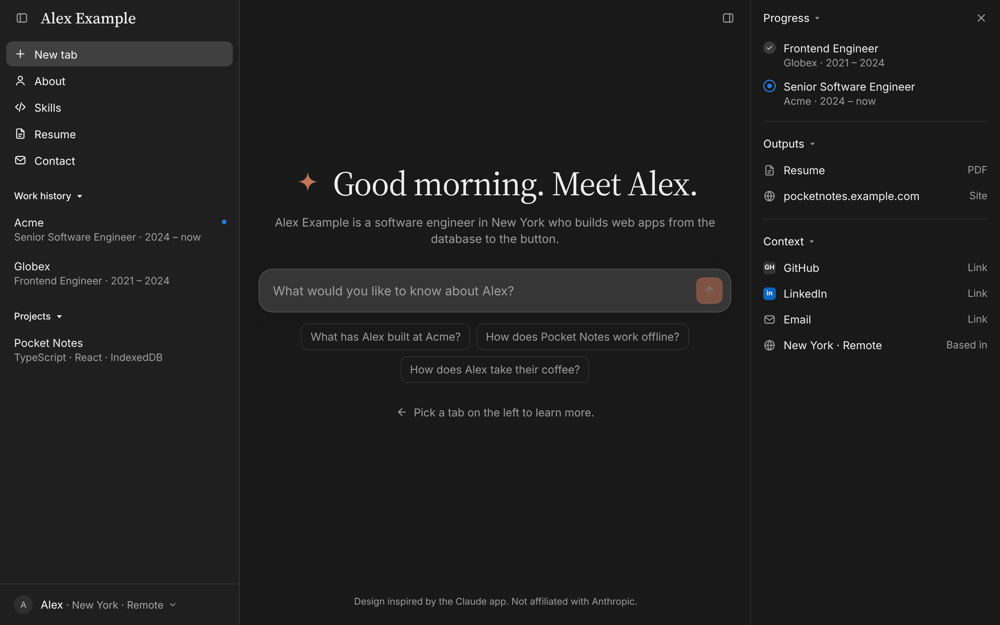

# Claude-app portfolio template

A portfolio laid out like the Claude app: a sidebar of tabs, each a short
conversation about you.



Everything the site says is in one file, `site.config.ts`. Astro builds it
into static HTML and CSS that work with JavaScript off, plus one small
script for the chats, menus and question card. An answer can hold more
than text: file cards, bars, flows, pictures, quotes, and diagrams that
move. A link you choose, such as a resume in Google Docs, can open in a
viewer beside the conversation instead of a new tab. An optional Worker on
Cloudflare, Ask, answers typed questions from your own answers, and quotes
the lines it answered from.

## Quick start

1. Click **Use this template** on GitHub, and clone your copy.
2. Install and run it. It needs Node 24 (the version in `.node-version`):

   ```sh
   npm ci
   npm run dev
   ```

   The site is at http://localhost:4321 and reloads as you edit.
3. Make it yours in two lines. `site.config.ts` begins with `me`, the
   facts the rest of the file reads: change `name` and `first`, save, and
   every tab is about you.
4. Change an answer. Further down, `threads` has each tab's questions (`q`)
   and answers (`a`). Your editor completes each field and says what it is
   for.
5. Check it:

   ```sh
   npm run build
   ```

   It names a field that is misspelt, and stops, naming the row, if
   something points at a tab that isn't there.

Then go through [Make it yours](#make-it-yours), and
[put it online](docs/deploy.md).

More of the sample: [a thread with a figure](.github/screenshots/figure.png),
[the question card](.github/screenshots/question-card.png),
["Something else"](.github/screenshots/something-else.png),
[on a phone](.github/screenshots/phone.png),
[in Japanese](.github/screenshots/japanese.png).

## Make it yours

A copy starts as the sample person, Alex Example. Replace or remove:

- [ ] `site.config.ts`: your facts, threads, answers and links
      ([What the site says](docs/content.md)). Delete what you don't use;
      the build names anything left pointing nowhere.
- [ ] `url` and `host` in `site.config.ts` ([Deploying](docs/deploy.md)).
- [ ] `public/assets/og.png`, the picture link previews show (1200×630). A
      screenshot of your home screen works.
- [ ] `public/assets/pocket-notes.webp`, the sample's picture: delete it,
      or replace it with one of yours.
- [ ] The sample's diagram, "Saving a note": `diagrams/saving-a-note.ts`,
      and the four files it is written to, `public/assets/saving-a-note*.svg`.
      Keep it as a model for your own ([Diagrams](docs/diagrams.md)), or
      delete all five once no answer shows it.
- [ ] The favicons, if you want your own: `public/assets/favicon.svg`,
      `public/assets/favicon-32.png` and
      `public/assets/apple-touch-icon.png`.
- [ ] `"name"` in `wrangler.jsonc`, your Worker's name on Cloudflare.
- [ ] `tests/ask-questions.json`, questions about you for Ask's eval (only
      if you use Ask).
- [ ] `examples/`, the sample in Japanese: delete it once you have taken
      what you want from it.
- [ ] What is about the template and not your site: this README and
      `tests/own-docs.test.ts`, which checks it; `.github/screenshots/`;
      `.github/CONTRIBUTING.md`, `.github/SECURITY.md`, and the issue and
      pull request templates beside them.
- [ ] `LICENSE`: add your name to the copyright line if you like; keep the
      original notice.

## Guides

The guides are in `docs/`, and update with the code they describe. An
update (`npm run update-template`) replaces the code your site shares
with the template, the guides and `AGENTS.md` among it, and never touches
your config, README, pictures, diagrams or `src/styles/site.css`:
[Updating](docs/updating.md) has the list.

| To… | Read |
| --- | --- |
| change what the site says: threads, answers, pictures, the viewer | [What the site says](docs/content.md) |
| put it online, on Cloudflare or any static host | [Deploying](docs/deploy.md) |
| add a language, or cut the Japanese fonts | [Languages and fonts](docs/languages.md) |
| draw a diagram that moves | [Diagrams](docs/diagrams.md) |
| let visitors type a question, and know what that can cost | [Ask](docs/ask.md) |
| know what protects the site and its visitors | [Security](docs/security.md) |
| take the template's later changes | [Updating](docs/updating.md) |
| change the code itself | [AGENTS.md](AGENTS.md), [Changing the code](docs/changing-the-code.md) |

Two of the sample's files are written to be copied:

- **A second language.** `examples/ja.ts` is the sample in Japanese. In
  `site.config.ts`, add `import japanese from "./examples/ja.ts";` and, in
  `languages` after `en`, `ja: japanese(me),`. Then cut its fonts, as
  [Languages and fonts](docs/languages.md#japanese-fonts) says.
- **A diagram.** `diagrams/saving-a-note.ts` draws "Saving a note", in the
  sample's Pocket Notes tab: lines are typed into a note, each is saved in
  the browser at once, the changes wait in a queue while there's no
  connection, and go to the server when it comes back.

## Commands

| Command | What it does |
| --- | --- |
| `npm run dev` | The site at localhost:4321, rebuilt as you edit |
| `npm run build` | Checks `site.config.ts`, then builds the site into `dist/` |
| `npm run preview` | Serves `dist/` as built |
| `npm run deploy` | Deploys to Cloudflare ([Deploying](docs/deploy.md)) |
| `npm run format` | Formats the code with Prettier |
| `npm run verify` | Everything CI checks: formatting, ESLint, unused code, types, the build and the unit tests, the HTML, the fonts and the pages in a browser |
| `npm run update-template` | Takes the template's latest shared code |

CI runs `npm run verify` on every pull request and every push to `main`.
To run it yourself, which matters once you change more than the config,
install its browser once:

```sh
npx playwright install chromium
npm run verify
```

It stops at the first failing step. Formatting is a step:
`npm run format` fixes it.

## Why Astro

Hand-written HTML and CSS with no build step would be a little quicker to
build and simpler to host, but hard to review and edit: the same markup
again for every tab, in every language. Astro components read like the
HTML they become, and what reaches the browser is still only plain HTML,
CSS and the site's one script, with no framework code.

## Credits and licence

Design inspired by the Claude app. Not affiliated with Anthropic. The fonts
are Inter, Source Serif 4, Geist Mono, Noto Sans JP and Noto Serif JP,
under the SIL Open Font License (texts in `public/assets/fonts/`).

MIT licensed: see `LICENSE`.
